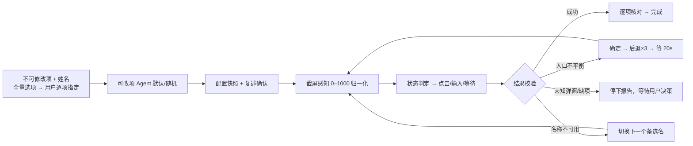

# Auto-WOW

> **面向真实桌面的声明式建号智能体技能（Agent Skill）**
> 不可修改项强制用户决策 · 可修改项自动默认/随机 · 全量选项枚举 · 逐帧视觉感知 · 状态机驱动 · 异常自愈重试

`Auto-WOW` 不是一个可执行程序，而是一份给 Agent 加载的**技能定义**：它把《魔兽世界：无限服》的角色创建流程拆成可验证的状态机，让具备桌面操作能力的 Agent 在**用户真实桌面**上完成「规则集 → 阵营 → 种族 → 职业 → 外观/体型 → 姓名 → 提交」的闭环，并在「阵营人口不平衡」或名称不可用时自动回退重试。

## 决策分层（核心原则）

| 类别 | 项目 | 谁来决定 |
|------|------|----------|
| **创建后不可修改** | 规则集、阵营、种族、职业、天裔分支 | **必须用户从全部可选项中逐项指定** |
| **实际锁定** | 姓名（名 + 姓，含 1–2 个备选名） | **必须用户提供**，无限服没有改名服务 |
| **创建后可修改** | 体型（性别）、发型/肤色等外观、HD/SD 模型 | **Agent 默认或随机**；用户主动指定时才按用户 |

这个分层把用户需要做的决策压缩到真正不可逆的项目上，外观类细节交给 Agent 快速完成，后续在理发店或选项菜单随时可改。

---

## 核心机制

| 能力 | 实现方式 |
|------|----------|
| **强制用户决策** | 不可修改项 + 姓名必须列全选项让用户选择，不替用户决定、不复用历史配置 |
| **自动决策** | 可修改项默认或随机，减少用户交互负担；用户想指定也随时可以覆盖 |
| **配置快照** | 开始前生成配置快照并复述确认，运行期只消费这份快照 |
| **视觉闭环** | 每一步操作前强制截屏，按当前帧 **0–1000 归一化坐标**读取按钮位置，不沿用旧帧坐标、不硬编码像素 |
| **状态机驱动** | 八个阶段按序推进，等待时长与跳转条件明确定义，不可逆项重复确认 |
| **异常自愈** | 识别「阵营人口不平衡」弹窗与名称不可用提示，分别进入回退循环和备选名队列 |
| **名字冗余** | 主动要求主名 + 1–2 个备选名，形成命名层容错队列 |
| **终态校验** | 成功后逐项核对必须项与姓名；可改项核对是否成功应用默认/随机结果 |

### 执行闭环



---

## 安装与触发

1. 将本仓库内容放到 Agent 的技能目录，例如：

   ```
   C:\Users\Administrator\.codebuddy\skills\Auto-WOW\
       SKILL.md
       references\flow-states.md
   ```

2. 刷新 Agent 后，用以下任一说法即可触发：

   - 「魔兽世界建号」
   - 「魔兽自动创建角色」
   - 「无限服建号」
   - 「阵营人口不平衡重试」

3. Agent 加载技能后，先让用户指定不可修改项与姓名，可改项自动决定，确认快照后才操作桌面。

> 运行环境要求：Agent 需具备 `computer_use_tool`（`plane="cu"`）与 `seed_computer_use` 能力。本仓库不含独立脚本，也不会自行启动游戏客户端。

---

## 全量可选项矩阵

### 第一层：规则集（必须用户指定，不可修改）

| 选项 | 核心规则 | 适合谁 |
|------|----------|--------|
| 普通（PVE） | 野外默认不可被敌对玩家攻击，PVP 需手动开启 | 新手、休闲、搬砖 |
| PVP | 争夺区域默认自由对抗，一个账号只能锁定一个阵营 | 喜欢野外阵营冲突 |
| RP（角色扮演） | 同 PVE，但命名与言行有严格规范 | 沉浸剧情、角色扮演 |
| RP-PVP | RP 规范 + 野外强制 PVP | 硬核扮演玩家 |
| 硬核（专家） | 一命模式，死亡即作废；开服时未开放 | 熟悉玩法的老手 |

> 不同规则集之间不能组队打副本（仅战场跨规则集匹配）；PVP 规则集的阵营锁是硬性的。

### 第二层：阵营与种族（必须用户指定，共 10 个种族）

- **部落**：兽人、亡灵、牛头人、巨魔、塑风者天裔
- **联盟**：人类、矮人、暗夜精灵、侏儒、高阶会天裔

天裔（塑风者 / 高阶会）需要「天裔英雄包」或更高礼包解锁；分支随阵营绑定。

### 第三层：种族 × 职业（必须用户指定，共 56 种组合）

| 阵营 | 种族 | 全部可选职业 |
|------|------|--------------|
| 部落 | 兽人 | 战士、猎人、潜行者、萨满祭司、法师、术士 |
| 部落 | 亡灵 | 战士、圣骑士、潜行者、牧师、法师、术士 |
| 部落 | 牛头人 | 战士、猎人、萨满祭司、德鲁伊 |
| 部落 | 巨魔 | 战士、猎人、潜行者、牧师、萨满祭司、法师、术士 |
| 部落 | 塑风者天裔 | 战士、猎人、潜行者、萨满祭司、德鲁伊 |
| 联盟 | 人类 | 战士、圣骑士、猎人、潜行者、牧师、法师、术士 |
| 联盟 | 矮人 | 战士、圣骑士、猎人、潜行者、牧师、萨满祭司 |
| 联盟 | 暗夜精灵 | 战士、猎人、潜行者、牧师、德鲁伊 |
| 联盟 | 侏儒 | 战士、潜行者、牧师、法师、术士 |
| 联盟 | 高阶会天裔 | 战士、猎人、潜行者、法师、德鲁伊 |

Agent 在用户选好种族后，只列出**该种族的全部合法职业**；用户要求看全局时可给出整张表。

### 第四层：体型、外观与姓名

| 字段 | 选项 | 决策方式 |
|------|------|----------|
| 体型（性别） | 体型 1（男性模型）、体型 2（女性模型） | **Agent 默认/随机**，用户可指定；外观页顶部中间 |
| 模型精度 | 高清（HD）、标清（SD） | **Agent 默认/随机**，用户可指定；只影响外观与动作 |
| 其他外观 | 发型、发色、肤色、脸型、纹身、瞳色、耳饰 | 默认不动，用户想随机可随机 |
| 姓名 | 主名 + 可选副名 + 1–2 个备选名 | **必须用户指定**；名 + 姓双段，RP 规则更严 |

---

## 创建后能否修改

| 不可修改（必须用户指定） | 可修改（Agent 默认/随机） |
|--------------------------|---------------------------|
| 规则集、阵营（PVP 锁）、种族、职业、天裔分支、姓名 | 体型（性别）、发型/肤色等外观、HD/SD 模型、幻化开关、天赋专精、副名显示 |

所以开始前只会对规则集 / 阵营 / 种族 / 职业 / 姓名做重点确认；体型、外观、HD/SD 由 Agent 快速决定，后续在理发店或选项菜单都能改回来。

---

## 状态机与节奏

| 阶段 | 界面识别特征 | 动作 | 等待 |
|------|--------------|------|------|
| 启动前 | 真实桌面 `main` + 游戏客户端 | 强制先截屏观察桌面与客户端状态，确认在 main | — |
| 0 | 战网规则集选择 | 按用户所选规则集点选 | 按界面反馈 |
| 1 | 登录界面出现「重新连接」 | 点击按钮 | 4 秒 |
| 2 | 规则 / 阵营页 | 核对规则与阵营，点「选择」 | 4 秒 |
| 3 | 左右阵营列 / 底部职业排 | 阵营 → 种族 → 职业 | 每步约 1 秒 |
| 4 | 右下角「自定外观」箭头 | 进入外观页 | 约 1 秒 |
| 5 | 体型 1/2、HD/SD 开关 | 用户指定则按指定；否则默认或随机 | 约 1 秒 |
| 6 | 主名 / 副名输入框 | 填名；失败依次换备选名 | 约 1 秒 |
| 7 | 右下角【完成】 | 提交并等待结果 | 按界面反馈 |

**关键恢复分支**

- **阵营人口不平衡**：弹窗「确定」→ 左下角「后退」两次 → 第三次后退需向按钮可见区域**下移一点**点击（旧坐标偏上会点空）→ 等 20 秒回登录页 → 用同一份配置与名字队列重跑。
- **名称不可用**：按备选名顺序重试当前命名步骤；主名与全部备选名均失败则停下报告。
- **未知弹窗 / 界面未按预期跳转**：先截屏重读状态，能识别确定/取消类按钮才处理；否则停下等待用户决策。

---

## 安全边界

> **不需要虚拟桌面**：该技能明确限定在真实桌面 `main` 上操作，禁止切到 pip 虚拟桌面；全程只点游戏窗口，不碰其他程序、不点右上角关闭按钮。我先截屏看一下当前桌面和游戏客户端状态。

- **启动前强制截屏**：每次任务开始先观察当前桌面与游戏客户端状态，确认在真实桌面 `main` 且游戏窗口可见；如确需指定桌面只允许 `cu.switch_desktop("main")`，禁止任何 pip / 虚拟桌面切换。
- 发现不在 `main` 时立即停止操作，切回后重新截屏确认，不在虚拟桌面继续点击。
- 只操作游戏窗口，不触碰其他桌面程序；**不点窗口右上角关闭按钮**。
- 每次点击前重新截屏，坐标以当前帧为准；分辨率或窗口尺寸变化不会导致点位漂移。
- 不缓存上一轮的角色配置，每一轮重试都沿用用户最初确认的同一份快照。
- 操作失败或中断后从登录界面重新进入，不在未知界面上盲目连点。

---

## 目录结构

```
Auto-WOW/
├── SKILL.md                    # 主手册：决策分层、全量选项、状态机、异常分支、成功判定
└── references/
    └── flow-states.md          # 界面识别、坐标约定、等待节奏、异常处置矩阵
```

---

## 来源说明

本项目的流程思路源自 [`DKCMJD51/moshou`](https://github.com/DKCMJD51/moshou)，并结合无限服规则集、全量选项矩阵与容错机制重新设计。角色选项信息参考 [Tabbit 分享会话](https://web.tabbit.com/share/chat/tLvz7YAXwMht) 与 [EndgameTools 种族职业组合表](https://endgametools.com/zh-CN/wow-forever/news/wow-forever-race-class-combinations)。原仓库未提供 LICENSE 文件；本仓库内容仅供个人学习与桌面自动化研究，使用时请自行遵守所涉游戏服务条款。

---

## 常见问题

**Q：为什么规则集/阵营/种族/职业必须我选，性别却不用？**
A：前四项创建后不可更改（PVP 阵营还是硬锁），选错只能重建角色；性别属于外观页的体型选项，创建后可在理发店修改，所以 Agent 默认或随机即可。

**Q：Agent 随机出来的体型/画质不满意怎么办？**
A：直接告诉 Agent 你的偏好重新建号，或创建后去理发店 / 选项菜单修改；这两项不影响角色属性。

**Q：为什么名字也要我给？**
A：无限服目前没有改名服务，名字等同锁定；且采用「名 + 姓」双段格式，重名判定看完整组合，提供 1–2 个备选名可让 Agent 自动跳过失败名。

**Q：能在后台虚拟桌面跑吗？**
A：不可以。技能明确限定真实桌面 `main`，禁止切到 pip 虚拟桌面，避免操作错窗口。
