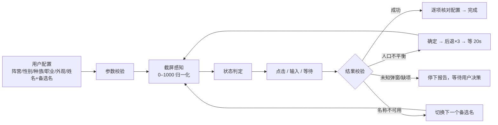

# Auto-MoShou

> **面向真实桌面的声明式建号智能体技能（Agent Skill）**
> 用户参数化配置 · 逐帧视觉感知 · 状态机驱动 · 异常自愈重试

`Auto-MoShou` 不是一个可执行程序，而是一份给 Agent 加载的**技能定义**：它把《魔兽世界》（WLK / 无限 PVP 服务器）的角色创建流程拆成可验证的状态机，让具备桌面操作能力的 Agent 在**用户真实桌面**上完成「登录 → 规则 → 建号 → 命名 → 提交」的闭环，并在「阵营人口不平衡」或名称不可用时自动回退重试。

所有角色配置——阵营、性别、种族、职业、外观、姓名——**均由用户在使用时指定**，技能不携带任何固定角色模板。

---

## 核心机制

| 能力 | 实现方式 |
|------|----------|
| **参数化解耦** | 开始前一次性采集用户配置，运行期只消费这份「配置快照」，不自行推断、不复用历史选择 |
| **视觉闭环** | 每一步操作前强制截屏，按当前帧 **0–1000 归一化坐标**读取按钮位置，不沿用旧帧坐标、不硬编码像素 |
| **状态机驱动** | 登录 / 规则 / 角色创建 / 外观命名 / 提交 五个阶段按序推进，等待时长与跳转条件明确定义 |
| **异常自愈** | 识别「阵营人口不平衡」弹窗与名称不可用提示，分别进入回退循环和备选名队列 |
| **名字冗余** | 主动要求主名 + 1–2 个备选名，形成命名层的容错队列，避免因重名/非法字符中断流程 |
| **终态校验** | 成功后逐项比对阵营、性别、种族、职业、外观、主名、副名，不一致绝不报成功 |

### 执行闭环



---

## 安装与触发

1. 将本仓库内容放到 Agent 的技能目录，例如：

   ```
   C:\Users\Administrator\.codebuddy\skills\Auto-MoShou\
       SKILL.md
       references\flow-states.md
   ```

2. 刷新 Agent 后，用以下任一说法即可触发：

   - 「魔兽世界建号」
   - 「魔兽自动创建角色」
   - 「帮我建个号」
   - 「阵营人口不平衡重试」
   - 「重新连接建号」

3. Agent 加载技能后，**先向用户收集配置**，确认完整后才开始操作桌面。

> 运行环境要求：Agent 需具备 `computer_use_tool`（`plane="cu"`）与 `seed_computer_use` 能力。本仓库不含独立脚本，也不会自行启动游戏客户端。

---

## 使用前需要准备的信息

| 字段 | 必填 | 说明 |
|------|------|------|
| 阵营 | 是 | 部落 / 联盟；规则页若有其他选项，以用户确认为准 |
| 性别 | 是 | 男性 / 女性 |
| 种族 | 是 | 确切名称，且必须属于所选阵营（如亡灵、兽人、人类） |
| 职业 | 是 | 确切名称（如圣骑士、法师、战士），不从旧配置推断 |
| 外观 | 否 | 默认沿用界面当前选择；有偏好时按用户描述调整 |
| 主名 | 是 | 原样输入，不翻译、不改写 |
| 备选名 | 建议 | 1–2 个，用于重名 / 非法字符 / 长度限制时自动接替 |
| 副名 | 否 | 用户不给则留空 |

若用户给出的种族与阵营冲突、职业与种族不搭配，或界面上找不到对应项，Agent 会**停下报告具体缺项**，不会擅自替换成别的配置。

---

## 状态机与节奏

| 阶段 | 界面识别特征 | 动作 | 等待 |
|------|--------------|------|------|
| 1 | 登录界面出现「重新连接」 | 点击按钮 | 4 秒 |
| 2 | 规则选择页，PVP 通常默认选中 | 按用户要求选规则并点「选择」 | 4 秒 |
| 3 | 顶部性别图标 / 左右阵营列 / 底部职业排 | 性别 → 阵营与种族 → 职业 → 外观 | 每步约 1 秒 |
| 4 | 右下角「自定外观」箭头 | 点击进入命名界面 | 约 1 秒 |
| 5 | 主名 / 副名输入框 | 填入用户姓名，失败则切换备选名 | 约 1 秒 |
| 6 | 右下角【完成】 | 提交并等待结果 | 按界面反馈 |

**关键恢复分支**

- **阵营人口不平衡**：弹窗「确定」→ 左下角「后退」两次 → 第三次后退需向按钮可见区域**下移一点**点击（旧坐标偏上会点空）→ 等 20 秒回到登录页 → 用同一份配置和名字队列从头重跑。
- **名称不可用**：按备选名顺序重试当前命名步骤；主名与全部备选名均失败则停下报告，不自行编造名字。
- **未知弹窗 / 界面未按预期跳转**：先截屏重读状态，能识别确定/取消类按钮才处理；否则停下等待用户决策。

---

## 安全边界

- 全程限定在真实桌面 `main`（`cu.switch_desktop("main")`），不切 pip 虚拟桌面。
- 只操作游戏窗口，不触碰其他桌面程序；**不点窗口右上角关闭按钮**。
- 每次点击前重新截屏，坐标以当前帧为准；分辨率或窗口尺寸变化不会导致点位漂移。
- 不缓存上一轮的角色配置，每一轮重试都沿用用户最初确认的同一份快照。
- 操作失败或中断后从登录界面重新进入，不在未知界面上盲目连点。

---

## 目录结构

```
Auto-MoShou/
├── SKILL.md                    # 技能定义：触发条件、配置采集、主状态机、异常分支、成功判定
└── references/
    └── flow-states.md          # 界面识别特征、坐标约定、等待节奏、异常处置矩阵
```

`SKILL.md` 是 Agent 加载时读取的主手册；`references/flow-states.md` 提供逐界面的识别与容错细节，仅在需要时加载。

---

## 成功判定

一次建号只有在以下条件**全部满足**时才算成功：

1. 不再出现「阵营人口不平衡」弹窗；
2. 角色进入角色选择列表或创建完成界面；
3. 阵营、性别、种族、职业、外观（有偏好时）、主名、副名与用户确认结果逐项一致。

任一条件不满足，都不得报告成功；未提交前可返回修改，已提交则按失败流程回退重来。

---


## 常见问题

**Q：为什么要备选名？**
A：游戏服务端可能判定重名、非法字符或长度超限。没有备选名时流程会卡在命名界面，只能人工介入；提供 1–2 个备选名后 Agent 可以自动接替。

**Q：能直接告诉我固定坐标吗？**
A：不能也不应该。不同分辨率、窗口大小和服务器 UI 版本下按钮位置会变；本技能使用当前帧 0–1000 归一化坐标，配合截屏识别，因此不依赖固定像素。

**Q：可以在后台虚拟桌面跑吗？**
A：不可以。技能明确限定真实桌面 `main`，禁止切到 pip 虚拟桌面，避免操作错窗口。

**Q：为什么 Agent 会停下来问我？**
A：遇到配置歧义（种族/阵营冲突）、界面找不到目标项、未知弹窗或备选名耗尽时，继续盲点风险高于收益，技能设计上要求停下并把具体情况交给用户决策。
